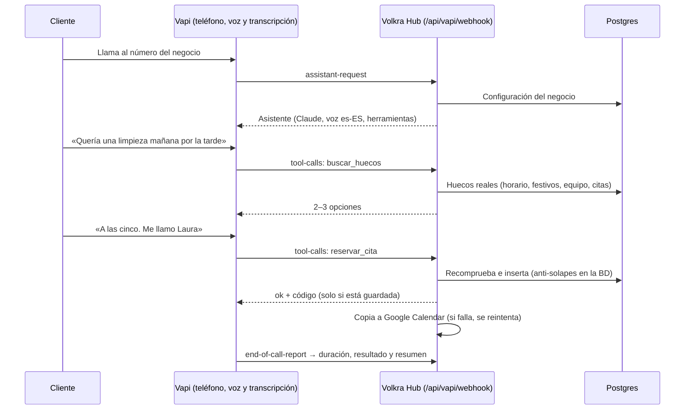

# Volkra Reception · Recepcionista con IA para negocios

> Agente de voz que atiende llamadas en español, consulta la agenda real del negocio y **reserva, cambia y cancela citas**. Producto SaaS multiempresa de Volkra · [app.volkra.es](https://app.volkra.es)


-D97757?logo=anthropic&logoColor=white)


### Lo más destacado

- **Agente telefónico con IA** (Claude + Vapi, voz es-ES) que usa herramientas reales: buscar huecos, reservar, cambiar, cancelar y pasar la llamada a una persona.
- **Motor de reservas robusto:** sin solapes aunque entren llamadas a la vez (restricción de exclusión en Postgres), idempotente ante webhooks repetidos, festivos, jornada partida y fechas habladas («el jueves que viene por la tarde»).
- **Multiempresa con aislamiento real** mediante Row Level Security; privacidad por diseño (no se graban llamadas ni se guardan transcripciones).
- **Omnicanal:** teléfono, chat web y WhatsApp Business, con el mismo motor.
- **117 tests automatizados** contra un Postgres real embebido (PGlite) con las migraciones de producción.
- **Demo local en 2 minutos**, sin cuentas externas.

**Stack:** Next.js 16 · React · TypeScript · Supabase/Postgres · PGlite · Claude API · Vapi · ElevenLabs · WhatsApp Cloud API · Google Calendar API · Vitest · Vercel

---

## Guía técnica · Volkra Hub

Plataforma de herramientas con inteligencia artificial de Volkra para negocios (https://app.volkra.es). El primer producto es **Reception**: un recepcionista con IA para negocios en España. Contesta llamadas en español de España, informa de horarios, precios y servicios, y **reserva, cambia y cancela citas en una agenda real**. Pasa la llamada a una persona cuando hace falta y deja todo registrado en un panel para el negocio.

El producto es multiempresa: el mismo sistema sirve a clínicas, peluquerías, talleres, academias, etc. El negocio de ejemplo es una **clínica dental ficticia de Madrid**. Hay un segundo negocio ficticio, un taller, para demostrar el aislamiento entre empresas.

> Todo el razonamiento del asistente lo hace **Claude** (Anthropic). No se usa nada del ecosistema de OpenAI.

---

## Arrancar en local (2 minutos, sin cuentas externas)

Requisitos: Node 20 o superior (probado con Node 24).

```bash
npm install
```

```bash
npm run dev
```

Abre http://localhost:3000 y entra con **Clínica Dental Alba (demo)**.

Sin variables de entorno, la app usa una **base de datos Postgres embebida** (PGlite, en `.data/pglite`). Esa base ejecuta las mismas migraciones y la misma seguridad por empresa que Supabase, y se rellena con datos de demostración marcados como «simulado». Para empezar de cero, borra la carpeta `.data/`.

Qué puedes probar sin credenciales:

| Pantalla | Qué hace |
|---|---|
| **Panel** | Métricas calculadas con consultas reales: llamadas, atendidas por IA, transferidas, citas, duración, horas ahorradas (estimación configurable) e incidencias |
| **Agenda** | Vista semanal; crear, mover y cancelar citas con las mismas validaciones que usa el asistente |
| **Llamadas** | Historial con resultado, resumen y lo que hizo el asistente en cada llamada |
| **Para revisar** | Recados, preguntas que el asistente no supo responder y errores |
| **Probar el asistente** | Simulador de llamada que usa la agenda real. Sin clave de Anthropic responde un guion local; con `ANTHROPIC_API_KEY` responde Claude con el mismo prompt y las mismas herramientas que en el teléfono |
| **Configuración** | Negocio, horario y festivos, servicios, equipo y ausencias, preguntas frecuentes, asistente de voz, privacidad e integraciones |

## Tests

```bash
npm test
```

Tests automatizados, contra un Postgres real embebido con las migraciones de producción:

| Requisito | Dónde |
|---|---|
| Reserva en horario disponible | `tests/booking.test.ts` |
| Intento de reserva en horario ocupado | `tests/booking.test.ts` |
| Intentos simultáneos sobre el mismo hueco | `tests/booking.test.ts` (2 tests + restricción de base de datos) |
| Modificación y cancelación de citas | `tests/booking.test.ts`, `tests/agent.test.ts` |
| Fuera de horario, festivos, horario especial | `tests/booking.test.ts` |
| Servicios de distinta duración | `tests/booking.test.ts` |
| Fallo de Google Calendar (al reservar y al buscar huecos) | `tests/booking.test.ts` |
| Repetición de un webhook | `tests/agent.test.ts`, `tests/booking.test.ts` |
| Transferencia a humano (en horario y fuera) | `tests/agent.test.ts`, `tests/simulator.test.ts` |
| Información que la IA desconoce | `tests/agent.test.ts`, `tests/simulator.test.ts` |
| Imposibilidad de acceder a datos de otra empresa (RLS y herramientas) | `tests/agent.test.ts` |
| Fechas en español («el jueves que viene», «por la tarde»…) | `tests/spanish-dates.test.ts` |
| Verificación de identidad al cambiar o cancelar | `tests/agent.test.ts` |
| Seguridad del webhook | `tests/agent.test.ts` |
| Avisos por email al negocio (recados y llamadas fallidas; un fallo de Resend no rompe la llamada) | `tests/alerts.test.ts` |
| Adaptador de ElevenLabs (firma verificada contra el SDK oficial, teléfono no suplantable) | `tests/elevenlabs.test.ts` |
| Chat web (límites, aislamiento, identidad sin teléfono) | `tests/webchat.test.ts` |
| WhatsApp (firma de Meta, mensajes repetidos, identidad por el número de WhatsApp) | `tests/whatsapp.test.ts` |

Otras comprobaciones: `npm run typecheck`, `npm run lint` y `npm run build`.

---

## Cómo funciona una llamada



Garantías del motor de reservas (`src/server/booking`):

- **Nunca inventa horas.** El asistente solo ofrece horas que devuelve `buscar_huecos`, y al reservar el servidor vuelve a calcular la disponibilidad.
- **Nunca confirma algo no guardado.** `reservar_cita` solo responde `ok` después de que la cita esté guardada.
- **Sin solapes, aunque lleguen llamadas a la vez.** Hay una restricción de exclusión en Postgres (`appointments_no_overlap`) por profesional y franja.
- **Idempotencia.** Si Vapi repite un webhook, se devuelve la misma respuesta y no se crea otra cita.
- **Zona horaria Europe/Madrid**, con festivos, horarios especiales, jornada partida, horario propio de cada profesional, ausencias, margen entre citas y antelación mínima y máxima.
- **Fechas habladas.** El servidor interpreta «el jueves que viene», «pasado mañana», «a última hora», etc., y el asistente siempre repite la fecha completa al confirmar.
- **Identidad.** Para cambiar o cancelar, la persona debe llamar desde el mismo teléfono (dato de la telefonía, no del modelo) o dar el código de la cita y su nombre.

## Arquitectura

```
src/
  app/                    Next.js 16 (App Router): panel, agenda, llamadas, simulador, configuración
    api/vapi/webhook      Servidor de Vapi (autenticado)
    api/google/*          OAuth de Google Calendar por negocio
    api/whatsapp/webhook  WhatsApp Business (Cloud API de Meta)
    api/cron/*            Reintento de sincronizaciones (Vercel Cron)
  server/
    booking/              Motor de reservas: disponibilidad, reservas, fechas en español
    agent/                Herramientas del agente, prompt, transferencias y registro de llamadas
    vapi/                 Asistente por llamada y procesado de los eventos de Vapi
    elevenlabs/           Adaptador para ElevenLabs Agents (inicio, herramientas, fin de llamada)
    webchat/              Conversaciones escritas (chat web y WhatsApp) con sus límites
    whatsapp/             Webhook de la Cloud API de Meta y envío de mensajes
    simulator/            Simulador: Claude o guion local (mismas herramientas)
    calendar/             Google Calendar (API REST) detrás de una interfaz sustituible
    db/                   Postgres (Supabase) o PGlite local; seed de demostración
supabase/migrations/      Esquema, RLS y funciones (sirve para Supabase y para PGlite)
scripts/                  db:migrate, db:seed-demo, vapi:connect
tests/                    Vitest
docs/                     Guías de puesta en marcha y estado del proyecto
```

- **Multiempresa con aislamiento real.** Cada tabla lleva `business_id` y Row Level Security. Las pantallas consultan como el usuario (rol `authenticated`), así que la base de datos solo le deja ver su empresa. El webhook de Vapi resuelve el negocio por el número llamado y filtra siempre por él.
- **Datos personales mínimos.** No se graban llamadas ni se guardan transcripciones. Los registros de llamadas no guardan el teléfono (solo los 4 últimos dígitos). El email solo se usa con consentimiento.

## Puesta en marcha real

1. [Supabase: base de datos y acceso](docs/01-supabase.md)
2. [Desplegar en Vercel](docs/02-vercel.md)
3. [Contratar un número y hacer la primera llamada](docs/03-telefono-y-primera-llamada.md)
4. [Google Calendar](docs/04-google-calendar.md)
5. [Decisiones técnicas (Vapi frente a Retell, modelos, privacidad)](docs/05-decisiones.md)
6. [ElevenLabs Agents como voz alternativa](docs/06-elevenlabs.md)
7. [Chat web](docs/07-chat-web.md)
8. [WhatsApp Business](docs/08-whatsapp.md)
9. **[Estado honesto: qué está hecho, qué está probado y qué falta](docs/ESTADO.md)**

Variables de entorno: ver [`.env.example`](.env.example).
